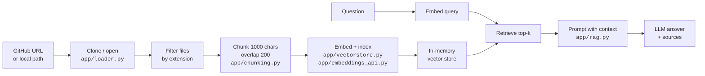

# 📚 RepoReader

Ask plain-English questions about any GitHub repository — answers are grounded strictly in the repo, with source citations.

**Live demo:** https://reporeader.srijan.website

<!-- Screenshot placeholder — replace with a real screenshot of the web UI -->
```
┌──────────────────────────────────────────────────────────────┐
│  📚 RepoReader            │  You                             │
│                           │  what model does this repo use?  │
│  Repository               │                                  │
│  [github.com/user/repo]   │  RepoReader                      │
│  [ Load repository ]      │  The model is a linear regression│
│                           │  on BMI: y = 998.578 × BMI ...   │
│  Answer with              │  ▸ Sources (2)                   │
│  ● Gemini      cloud      │                                  │
│  ○ Hugging Face  no key   │                                  │
│  Context chunks (k): 4    │  [ Ask something…    ] [ Ask ]   │
└──────────────────────────────────────────────────────────────┘
```

---

## Features

- **RAG over any GitHub repository** — paste a `https://github.com/...` URL (or a local path outside production) and chat with the codebase.
- **Grounded answers only** — the model is instructed to answer *solely* from the retrieved context and to never use outside knowledge.
- **`Not found in repository.` fallback** — when the retrieved chunks don't contain the answer, that exact string is returned instead of a guess.
- **Multiple providers** — **Gemini** and **Hugging Face** built in, plus a **Use my own API key** toggle that points at any OpenAI-compatible endpoint.
- **Adjustable context** — a `k` slider (web) / `-k` flag (CLI) controls how many chunks are retrieved, from 1 to 10 in the web UI.
- **Source citations** — every answer carries the file names it was built from, deduplicated and sorted, shown in an expandable panel.
- **CLI and web UI share one pipeline** — both `main.py` and `server.py` call the same `app/rag.py` functions, so answers are identical.

---

## How it works



As a plain-text flow:

```
repo ──▶ load ──▶ filter ──▶ chunk ──▶ embed ──▶ in-memory vector store
                                                          │
question ──▶ embed query ──▶ retrieve top-k ◀─────────────┘
                                    │
                                    ▼
                         prompt (context + question) ──▶ LLM ──▶ answer + sources
```

**Details that matter:**

- Files are filtered by extension and by excluded directory (`.git`, `__pycache__`, `node_modules`, `venv`, `.env`).
- Chunks are 1000 characters with a 200-character overlap, and each is prefixed with `[filename: <name>]` so questions naming a file match it.
- Notebooks (`.ipynb`) are parsed cell by cell — only real code and markdown are indexed, not raw JSON, base64 images or rendered HTML.
- The guardrail prompt lives in `app/rag.py` as `SYSTEM_PROMPT`; `NOT_FOUND` is the literal `"Not found in repository."`.

---

## Tech stack

| Layer | What is used |
|---|---|
| Web server | Flask 3.1 + gunicorn |
| Orchestration | LangChain Core, `langchain-text-splitters` |
| Embeddings (local) | `sentence-transformers/all-MiniLM-L6-v2` via `langchain-huggingface` (torch) |
| Embeddings (API) | Gemini `gemini-embedding-001` over a plain REST call in `app/embeddings_api.py` |
| Vector store | LangChain `InMemoryVectorStore` |
| LLMs | Gemini via `langchain-openai`'s `ChatOpenAI`; `meta-llama/Llama-3.3-70B-Instruct` via HF Inference Providers (Together); any OpenAI-compatible endpoint |
| Repo access | GitPython |
| Frontend | Plain HTML/CSS/JS, no framework and no build step |

---

## Project structure

```
.
├── main.py                 # CLI entry point (local only)
├── server.py               # Flask API + static file server
├── static/
│   ├── index.html          # UI markup
│   ├── style.css           # UI styles
│   └── app.js              # UI logic (fetch, render, state)
├── app/
│   ├── __init__.py
│   ├── config.py           # env-driven settings and limits
│   ├── loader.py           # file discovery, notebook parsing, is_remote()
│   ├── chunking.py         # chunking + [filename: ...] tags
│   ├── vectorstore.py      # embedding selection, index, retrieval
│   ├── embeddings_api.py   # Gemini embeddings over REST, no torch
│   ├── rag.py              # retrieval + generation glue, guardrail prompt
│   └── llm.py              # model factories and key resolution
├── requirements.txt        # all dependencies (both embedding backends)
├── render.yaml             # Render blueprint
├── .python-version         # 3.12 (pinned for Render)
├── .env.example            # template — copy to .env and add your keys
├── pyproject.toml          # uv project metadata (local, Python >=3.14)
└── uv.lock
```

---

## Run locally

```bash
git clone https://github.com/JellyFishJuggler/RepoReader.git
cd RepoReader

# Create and activate a virtual environment
python -m venv .venv
source .venv/bin/activate          # Windows: .venv\Scripts\activate

# Install dependencies (includes the torch-based MiniLM embeddings)
pip install -r requirements.txt
```

Create a `.env` file in the project root. Placeholders only — never commit real keys:

```dotenv
# Optional: used by the "Gemini" answer source and by API embeddings
GEMINI_API_KEY=your_gemini_key_here

# Optional: used by the "Hugging Face" answer source
HUGGINGFACEHUB_API_TOKEN=your_hf_token_here

# Embedding backend: "local" (default) or "api"
EMBEDDINGS=local
```

Start the server and open the UI:

```bash
python server.py
# → http://127.0.0.1:5000/
```

Local behaviour (all of this is deliberate):

- Local filesystem paths are accepted as well as GitHub URLs.
- The server's own key from `.env` is used when you don't supply one.
- The default **Gemini** source uses `GEMINI_API_KEY` from `.env`; the key never leaves the server.
- Wildcard CORS is enabled so the UI can also be served from another origin (e.g. VS Code Live Server on port 5500, where `static/app.js` automatically targets `http://127.0.0.1:5000/`).

### CLI (local only)

`main.py` is a development tool and is **not deployed**. It always uses the local torch MiniLM embeddings and does not honour `EMBEDDINGS=api`.

```bash
# Interactive session
python main.py -r https://github.com/JellyFishJuggler/diabetes-slr.git

# One-shot question
python main.py -r https://github.com/JellyFishJuggler/diabetes-slr.git -q "what libraries are used?"

# Local folder
python main.py -r ../my-codebase -q "how does the auth middleware work?"
```

| Flag | Description | Default |
|---|---|---|
| `-r, --repo` | GitHub URL or local path (prompts if omitted) | — |
| `-q, --query` | Ask one question and exit | interactive loop |
| `-k, --k` | Number of context chunks to retrieve | `4` |

---

## Configuration

All settings are read from the environment (or `.env` locally). Every variable below is read by the code.

| Variable | Default | What it does |
|---|---|---|
| `EMBEDDINGS` | `local` | Embedding backend. `local` uses torch MiniLM; `api` uses Gemini over REST and never imports torch. |
| `PRODUCTION` | *(unset)* | Truthy values `1`, `true`, `yes` enable production hardening: GitHub-only URLs, own-key-only answers, no wildcard CORS. |
| `PORT` | `5000` | Port for `python server.py`. On Render this is injected. |
| `HOST` | `127.0.0.1` | Bind address for `python server.py`. |
| `GEMINI_API_KEY` | *(unset)* | Gemini key. Also accepted as `GOOGLE_API_KEY`. Used by the Gemini source and by API embeddings (outside production). |
| `HUGGINGFACEHUB_API_TOKEN` | *(unset)* | HF token. Also accepted as `HF_TOKEN` or `TOGETHER_API_KEY`. Needs Inference Providers credits. |
| `GEMINI_EMBED_MODEL` | `gemini-embedding-001` | Embedding model name for `EMBEDDINGS=api`. |
| `GEMINI_EMBED_DIMS` | `768` | Requested output dimensions (`outputDimensionality`). The model's native size is 3072; 768 keeps memory small. |
| `EMBED_BATCH_SIZE` | `100` | Texts per `batchEmbedContents` request. |
| `EMBED_TIMEOUT_SECONDS` | `60` | Per-request timeout for embedding calls. |
| `EMBED_MAX_RETRIES` | `4` | Attempts before failing, with exponential backoff on 429/5xx. |
| `CLONE_TIMEOUT_SECONDS` | `60` | Clone timeout (applied on POSIX; GitPython does not support it on Windows). |
| `MAX_REPO_FILES` | `400` | Maximum file count in a cloned repo. |
| `MAX_REPO_BYTES` | `83886080` (80 MB) | Maximum total repository size. |
| `PYTHON_VERSION` | `3.12` (set in `render.yaml`) | Python version requested from Render. |
| `OLLAMA_BASE_URL` | `http://localhost:11434/v1` | Present only in commented-out Ollama code; Ollama support is currently disabled. |

---

## Deployment on Render

The repo ships a `render.yaml` blueprint.

```yaml
services:
  - type: web
    name: reporeader
    runtime: python
    plan: starter
    buildCommand: pip install -r requirements.txt
    startCommand: gunicorn server:app --workers 1 --threads 4 --timeout 120 --bind 0.0.0.0:$PORT
    healthCheckPath: /api/status
```

**To deploy:**

1. Push the repo to GitHub.
2. In Render, choose **New → Blueprint** and point it at the repository.
3. Render reads `render.yaml` and prompts for the two secrets marked `sync: false` — `GEMINI_API_KEY` and `HUGGINGFACEHUB_API_TOKEN`.
4. Deploy.

**Blueprint environment variables:**

| Key | Value |
|---|---|
| `PYTHON_VERSION` | `3.12` |
| `EMBEDDINGS` | `api` |
| `PRODUCTION` | `1` |
| `GEMINI_EMBED_MODEL` | `gemini-embedding-001` |
| `GEMINI_EMBED_DIMS` | `768` |
| `GEMINI_API_KEY` | `sync: false` — prompted at deploy time |
| `HUGGINGFACEHUB_API_TOKEN` | `sync: false` — prompted at deploy time |

**Single worker on purpose.** The index lives in the process-local `_stores` dict, so more than one worker would mean inconsistent caches. `--workers 1 --threads 4` keeps state coherent while still handling concurrent requests. The `healthCheckPath` is `/api/status`, which returns 200 regardless of whether keys are configured, so a missing key never fails a deploy.

**What `PRODUCTION=1` changes:**

- Only `https://` URLs on hostnames in the allow-list (`github.com`) are accepted; local paths are rejected.
- Answers must use the caller's own key — the server's `.env` key is never spent on a visitor.
- Wildcard CORS headers are no longer added; requests are same-origin only.
- Clones are depth-1, single-branch, and subject to the file-count and size caps.

A free instance works, with the caveats listed under **Limitations**.

---

## Limitations

These are real, current behaviour — all verifiable in the code.

**Embedding rate limits and indexing caps**
- Gemini's free tier rate-limits embedding requests. `app/embeddings_api.py` retries with exponential backoff on 429/5xx up to `EMBED_MAX_RETRIES` (default 4), then fails with *"Gemini rate limit hit while embedding. Try a smaller repository."*
- Indexing is capped by `MAX_REPO_FILES` (400 files) and `MAX_REPO_BYTES` (80 MB). Either limit rejects the repo with a clear error.
- Embedding throughput is bounded by `EMBED_BATCH_SIZE` (100 texts per request) and `EMBED_TIMEOUT_SECONDS` (60 s per request), so a mid-size repo takes a noticeable amount of time to index.

**Repository access**
- In production only public GitHub repos over `https://` are allowed. Local paths are disabled when `PRODUCTION=1`, and non-GitHub hosts are rejected.
- Clone timeout is `CLONE_TIMEOUT_SECONDS` (60 s), applied on POSIX. GitPython raises outright on Windows if it is passed, so it is skipped there.

**In-memory, per-process state**
- The index lives in `_stores` in the server process. It is lost on every restart or redeploy.
- It is not shared between workers, which is why the deployment pins a single gunicorn worker.
- There is no eviction: indexed repos accumulate for the lifetime of the process, and temporary clones are held on disk for as long as their store is cached.

**Render free tier**
- Cold starts: the instance sleeps after inactivity and takes roughly 50 seconds to wake, so the first request after a period of idleness is slow.
- Limited RAM, and the embedding call for a large repo can be memory-intensive.

**Production key handling**
- With `PRODUCTION=1`, users must supply their own API key — the "Use my own API key" toggle must be on, and the server's key is not used for answering.
- Keys are sent per request, and are never stored in the index cache or written to logs. `GeminiEmbeddings.__repr__` deliberately omits the key. Only the *source* of the key (`user` or `server`) is logged.

**Retrieval quality**
- API embeddings (Gemini, 768 dims) and local MiniLM embeddings (384 dims) are different models and give slightly different retrieval results for the same question.
- Answers depend entirely on the retrieved chunks. Information outside the top-`k` is invisible to the model, and it will correctly answer `Not found in repository.` rather than guess — which can look like a miss when the fact exists somewhere in the repo.
- Retrieval is dense-only: pure similarity search with no keyword layer and no reranking. Markdown tables embed poorly, so abstract phrasings of a question can rank the right chunk below the top-`k`.
- No code execution, no AST or call-graph analysis, and no cross-file reasoning — the model only sees text chunks.

**Product scope**
- No persistence, no authentication, and no per-user isolation. Anyone who can reach the deployment shares the same process and the same in-memory index cache.

---

## Security notes

- **`.env` is gitignored.** `.gitignore` ignores `.env` and `.env.*` and re-includes only the template `!.env.example`, which contains placeholders.
- **No keys in the repo.** Keys are read at runtime from the environment, with `.env` used locally via `python-dotenv`. `load_dotenv(ENV_PATH, override=False)` means real environment variables always win over the file, which is what a hosted deployment needs.
- **Key source resolution.** `app/llm.py::resolve_embedding_key` prefers the caller's own key, then falls back to the server key only when `PRODUCTION` is unset, and otherwise raises a clear error.
- **Keys never logged.** The embedding log line records only `key source: user` or `key source: server`. The startup `log_key_status()` prints the presence, variable name and length of each key — never the value.
- Wildcard CORS headers (`Access-Control-Allow-Origin: *`, plus allowed headers and methods) are added by `_headers` only outside production. With `PRODUCTION=1`, the API is same-origin and no CORS headers are emitted. (Note: Flask's automatic OPTIONS handling answers preflight before the `/api/<path:_any>` OPTIONS route is reached, so that route always returns 200 rather than 204.)
- **Static file path traversal.** Static assets are served with `send_from_directory`, which rejects `..` escapes. Traversal attempts such as `/../.env`, `/%2e%2e/.env`, `/..%2f.env` and backslash variants all return 404.
- **Repo source validation.** In production, `_validate_repo_source` rejects anything that is not an `https://` URL on an allow-listed host.
- **Resource caps as a safety net.** Clone timeout, file count and total size limits also bound the damage a hostile repository could do.

---

## Future improvements

- [ ] **Persistent vector store** (e.g. Chroma or pgvector) so reindexing doesn't happen on every restart.
- [ ] **Cache by commit SHA** so an unchanged repo is never embedded twice.
- [ ] **Streaming answers** so long responses appear token by token.
- [ ] **Private repo support** via a user-supplied access token.
- [ ] **Markdown rendering** of answers instead of escaped plain text, so code blocks and lists display properly.
- [ ] **Cross-encoder reranker** (retrieve more, rerank, then keep top-`k`) to improve recall on table-heavy and phrase-sensitive questions.
- [ ] **Hybrid keyword + dense retrieval** for exact-term queries.
- [ ] **Per-user isolation and eviction** so one visitor's index doesn't occupy memory forever.
- [ ] **Re-enable Ollama** — the code is present in `app/llm.py` but commented out.

---

## License & author

No license file is currently included in this repository.

Built by **Srijan** — [@JellyFishJuggler](https://github.com/JellyFishJuggler) — guptasrijan85@gmail.com
